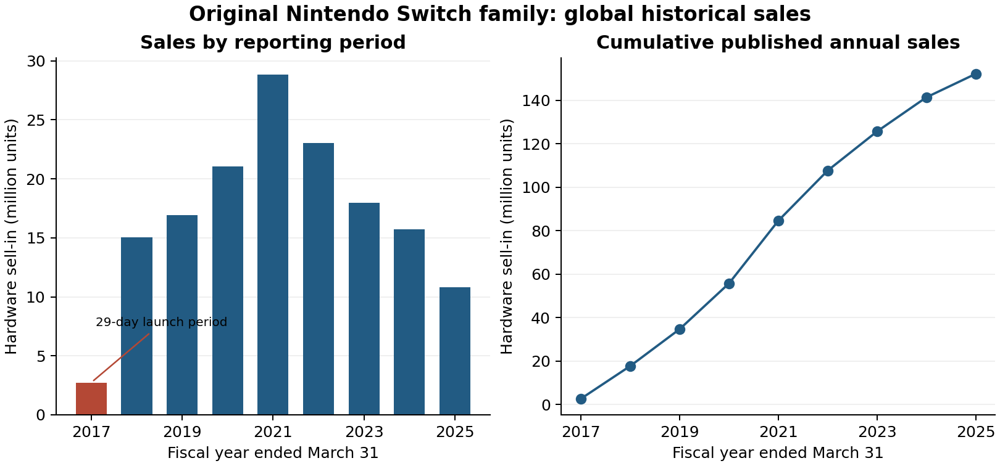
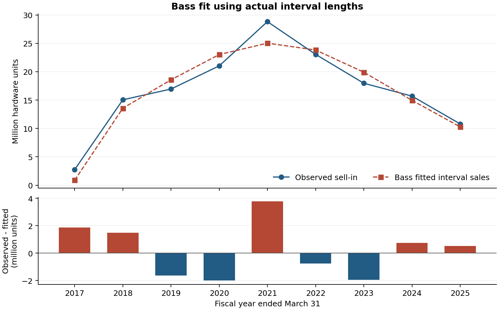
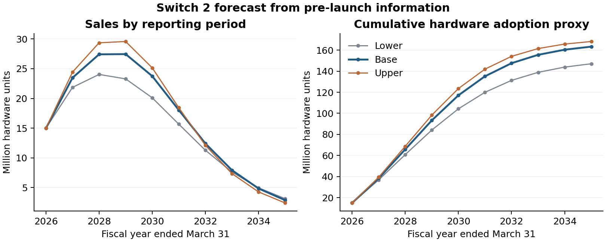
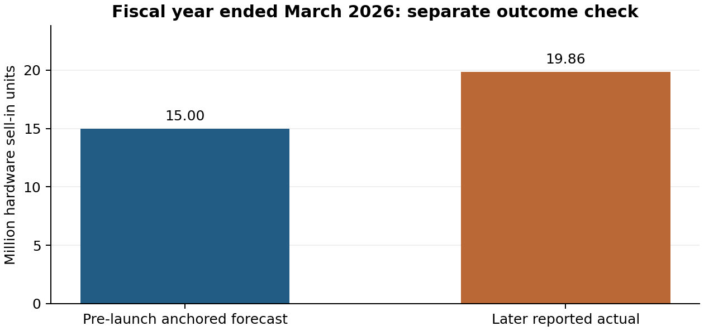

# Nintendo Switch 2: A Bass Model Forecast

**Robert Sarinyan**

Marketing Analytics

## 1. Selected innovation and research objective

I selected **Nintendo Switch 2** from TIME's Best Inventions of 2025 (Stokel-Walker, 2025). It can be played handheld or plugged into a TV, just like the original Switch. It provides enhanced performance and additional features like GameChat. Nintendo announced its launch date as June 5, 2025 (Nintendo, 2025c). For this report, I fit a Bass model to sales of the original Switch and use it to predict future worldwide Switch 2 sales.

I performed the analysis in October 2026, but constructed the forecast based on data available until May 9, 2025, prior to console release. This allows me to compare the first period forecast with a later sales figure.

## 2. Historical comparison and justification

The historical comparison was the **original Nintendo Switch**, released on March 3, 2017 (Nintendo, 2017). The two consoles are both handheld and TV capable, come from the same manufacturer, and draw on familiar Nintendo titles. Compatible original Switch games are also playable on Switch 2. For these reasons, the first Switch is a useful guide to possible demand for the second one. Nintendo did a similar comparison when discussing its initial Switch 2 sales forecast, and it also pointed out that the price increase may lead to more challenging sales (Nintendo, 2025b, Q1). The two consoles are very similar, but their sales may grow at different rates.

The original Switch has an interesting sales history as well. The reports from Nintendo encompassed their rise and fall, so there is sufficient data to calculate a complete diffusion curve (Nintendo, 2017, 2019, 2021, 2023, 2025a). The figures include all of the original Switches, with Lite and OLED versions included where applicable. I maintain that definition for the analysis. Switch 2 is already known to have an audience and a big library of games, and its price, competition, and release schedule could yield a different sales curve. I thus take the historical model as the basis, then modify it according to Nintendo's pre-launch forecast, and compare the results with various assumptions.

## 3. Scope, measurement and timing

I opt for a **global scope** as Nintendo provides global hardware figures for Japan, the Americas, Europe and other markets (Nintendo, 2025a, p. 27). The historical data and forecast thus cover the same area. This provides a helpful overview, but cannot reveal price, supply or demand differences between countries.

The data refer to sell-in, or how many consoles Nintendo sells into the distribution channel. This is not the same as sell-through, which is based on sales to consumers (Nintendo, 2025a, pp. 11-12). Software, accessories, revenue and active accounts are not included. It would be best if the first console bought by each buyer was counted. I can't tell who those buyers are from these data, so I take console sales as an approximation of adoption. Some units may be repeat purchases or remain in stores. Totals and market potential M in the model are hardware units and not unique people or households.

The historical series is from March 3, 2017 to March 31, 2025. Only 29 days are observed in the first period. The first forecast period for Switch 2 is 300 days from June 5, 2025 to March 31, 2026. Later periods are based on Nintendo's fiscal year (April to March). I measure elapsed time as calendar days divided by 365.25 and include the final day of each reporting period. Forecasts are provided over 10 reporting periods to the end of March 2035 to show the growth and decline of the model. This endpoint is a choice for the analysis, not an estimate of when Nintendo will stop selling the console.

## 4. Historical data, preparation and exploration

I took nine hardware sales observations from Nintendo's financial reports from around the world. Sales are given in tens of thousands in the tables, hence divide by 100 to get the numbers in millions. Some years are taken from the previous year's Actual column in the following report. I used real sales for all of the cells and removed the forecast column. The following source IDs provide a connection between each observation and a report in the reference list and the source register. The register also lists the dates of publication, URLs, local copies and page numbers.

| Fiscal year end | Sales (millions) | Source / PDF page |
| --- | --- | --- |
| 2017 (launch only) | 2.74 | N2017, p. 15 |
| 2018 | 15.05 | N2019, p. 14 |
| 2019 | 16.95 | N2019, p. 14 |
| 2020 | 21.03 | N2021, p. 14 |
| 2021 | 28.83 | N2021, p. 14 |
| 2022 | 23.06 | N2023, p. 14 |
| 2023 | 17.97 | N2023, p. 14 |
| 2024 | 15.70 | N2025, p. 27 |
| 2025 | 10.80 | N2025, p. 27 |

I kept every observation and calculated its duration and cumulative sales. No years were filled in, and the 29-day launch total was not scaled up to a full year. Adding the annual figures gives 152.13 million units, while Nintendo reports 152.12 million lifetime units at March 2025 (Nintendo, 2025a, p. 27). This small difference is consistent with rounding. I kept both published figures as they are. Converting them to individual units does not make the original numbers more precise.

Sales reached 28.83 million units in the year ended March 2021 and fell to 10.80 million by March 2025. This rise and decline make a Bass curve worth testing. Still, sales were affected by more than adoption alone. Nintendo's reports describe pandemic conditions and component shortages (Nintendo, 2021, 2023). New models, repeat purchases, and game releases may also help explain changes from year to year.

## 5. Historical Bass estimation

### 5.1 Model and fitting method

In the Bass model, N(t) is cumulative sales in millions and M is the total number of hardware units the market may eventually absorb. The coefficient p represents outside influences on adoption, while q represents imitation as adoption spreads (Bass, 1969):

$$\frac{dN(t)}{dt}=\left(p+q\frac{N(t)}{M}\right)(M-N(t))$$

Starting from N(0) = 0 gives:

$$N(t)=M\frac{1-\exp(-(p+q)t)}{1+(q/p)\exp(-(p+q)t)}$$

Sales during a reporting period are cumulative sales at the end minus cumulative sales at the start:

$$\widehat{S}_i=N(b_i)-N(a_i)$$

I estimate p, q, and M by minimizing the sum of squared differences between observed and predicted sales in each reporting period. Every observation has the same weight. This follows the approach in Srinivasan and Mason (1986, Section 2, equation 1, p. 170). Using the exact period boundaries lets the model handle the short launch period. The paper supports this method, while the optimizer settings and checks described below are choices made for this project.

I use SciPy's nonlinear least-squares optimizer and require positive p and q. M must exceed the 152.13 million units already observed. To check that the answer does not depend on the starting guess, I run the fit from 27 starting combinations. All reach the same squared-error total within 0.000001, and the selected fit does not hit a search bound. The code and result JSON record the settings. A separate numerical solution of the Bass differential equation also agrees with the formula above.

### 5.2 Estimates and fit diagnostics

| Parameter | Historical estimate | Meaning |
| --- | --- | --- |
| p | 0.06497 per year | External-influence rate |
| q | 0.46426 per year | Imitation coefficient |
| M | 167.29 million | Eventual hardware-unit potential |

Both p and q are yearly rates. They do not tell us what share of customers came from a particular marketing channel. Here q is larger than p, so the model allows adoption to speed up as earlier adoption grows. This alone does not prove that word of mouth caused the increase. M is an estimated long-run hardware total.

The fit has an R-squared of 0.9277. Its root mean squared error (RMSE) is 1.88 million units per reporting period, and its mean absolute error (MAE) is 1.64 million. For the eight full-year observations alone, the same fitted model has an R-squared of 0.8680. The lower figure is useful context because the small launch-period total makes the all-period R-squared look stronger. These measures describe how well the model fits the historical sample, not how well it predicts future sales.

The model follows the broad rise and decline, but misses some important periods. It predicts 25.04 million units for the year ended March 2021, which is 3.79 million below the actual 28.83 million. It also predicts just 0.88 million for the launch period, compared with 2.74 million observed. A smooth curve cannot fully capture the launch rush or changes in supply and demand.

### 5.3 Historical sensitivity

I checked how much the estimates depend on the launch observation. Treating the 2.74 million launch sales as already reached on April 1, 2017 and fitting the next eight periods gives p = 0.05934, q = 0.47227, and M = 168.84 million. The main result still uses all nine observations. I also refitted the model nine times, leaving out one period each time. This gives ranges of 0.05769-0.07060 for p, 0.39163-0.51223 for q, and 161.57-171.18 million for M. Each check keeps M above the same full-history sales total. These ranges show sensitivity to the sample. They are not confidence intervals or tests on new data.

## 6. Switch 2 parameter transfer and diffusion forecast

### 6.1 Evidence, assumptions and calibration

For the base forecast, I keep the original Switch's q = 0.46426. The shared brand and compatible games give some reason to expect similar diffusion, although the exact rate may differ. I also use its fitted M = 167.29 million as the Switch 2 market potential. This assumes the two generations can reach similar total hardware sales. It is an assumption based on the earlier console, not a separate measurement of the Switch 2 market.

The scale comes from Nintendo's reported 152.12 million original Switch units by March 2025 and the fitted curve's remaining 15.17 million units. Together, they give the 167.29 million benchmark. This does not assume that every Switch owner will upgrade or that the number equals the worldwide gaming population. Since there is no independent long-run Switch 2 market estimate in the inputs, I check other market sizes below.

Nintendo forecast **15 million Switch 2 hardware units for the year ending March 2026** in its May 8, 2025 results (Nintendo, 2025a, p. 9, and 2025b, Q1). Copying all three historical parameters would produce only 10.48 million over the 300-day launch period. I therefore hold q and M fixed and solve N(300/365.25) = 15 for p. This gives **p = 0.09450 per year**. The higher rate allows for a stronger start, which is plausible for a successor with an existing audience. It is chosen to match the published forecast, not estimated from actual Switch 2 sales.

This first-period result matches Nintendo's guidance by construction. It is not evidence that the model predicts accurately. The later periods follow from the Bass curve and the chosen assumptions. If the guidance or assumed market size is wrong, the forecast will also be affected.

### 6.2 Sensitivity cases

I use three cases to see how the forecast changes. The lower case takes the 152.12 million original Switch units already reported as its market potential and uses the lowest q from the omitted-period checks. The upper case uses the largest M and q from those checks. The base case uses the main historical estimates. In each case, I solve for p again so that first-period sales equal 15 million. The table therefore combines published sales, estimated historical parameters, and the assumptions just described.

| Case | p / q (per year) | M (million units) |
| --- | --- | --- |
| Lower | 0.10773 / 0.39163 | 152.12 |
| Base | 0.09450 / 0.46426 | 167.29 |
| Upper | 0.09037 / 0.51223 | 171.18 |

The case names refer to lower and higher long-run volumes. They are not guaranteed limits or confidence intervals, and the chosen M and q need not come from the same historical refit. All cases start at 15 million, so they do not test uncertainty about first-period guidance. Actual demand could be below the lower case or follow a different shape. Annual sales can also cross later because each case approaches its market potential at a different speed.

### 6.3 New and cumulative units by period

| Fiscal year end | New units (millions) | Cumulative (millions) |
| --- | --- | --- |
| 2026 (300 days) | 15.00 | 15.00 |
| 2027 | 23.47 | 38.47 |
| 2028 | 27.41 | 65.88 |
| 2029 | 27.45 | 93.33 |
| 2030 | 23.75 | 117.09 |
| 2031 | 18.05 | 135.14 |
| 2032 | 12.44 | 147.57 |
| 2033 | 7.94 | 155.52 |
| 2034 | 4.87 | 160.38 |
| 2035 | 2.90 | 163.28 |

In the base case, annual sales are highest around the years ended March 2028 and 2029. The maximum is 27.45 million in fiscal 2029. Cumulative sales reach 163.28 million by March 2035, still below M. The table rounds each entry separately, while the calculations use full precision.

| Case | Peak fiscal year end | Cumulative by March 2035 |
| --- | --- | --- |
| Lower | 2028 | 147.03 million |
| Base | 2029 | 163.28 million |
| Upper | 2029 | 168.16 million |

All figures cover worldwide hardware units. They approximate adoption but cannot tell us how many unique people buy a Switch 2. Each period uses its actual number of calendar days.

## 7. Separate outcome check and conclusions

Nintendo later reported **19.86 million Switch 2 hardware units sold into distribution for the year ended March 2026** (Nintendo, 2026, p. 5). This result was published after the forecast's information cutoff. I keep it in a separate data file and use it only to check the completed forecast. It does not enter the historical fit or the choice of Switch 2 parameters.

The 15.00 million forecast is **4.86 million below the actual result**. Forecast minus actual is -4.86 million, and the absolute percentage error is **24.47%**, calculated relative to actual sales. All three cases have the same miss because they share the same starting target. This shows the risk of relying on management guidance. I leave the error visible instead of changing the pre-launch model to fit a result that became known later.

The original Switch gives a useful starting point for modeling its successor, but the results depend strongly on the assumptions about market size and diffusion speed. The Bass curve captures a broad rise and decline. It cannot separately account for launch inventory, prices, marketing, competition, or new models. The small historical sample and the use of hardware sales instead of first-time buyers also limit what can be concluded. I would use the longer-term cases as planning examples, rather than precise sales predictions. For a business decision in October 2026, I would update the model with newer information. Here I keep the pre-launch cutoff so the exercise can be checked fairly against the later outcome.

## References

Bass, F. M. (1969). *A new product growth for model consumer durables*. Management Science, 15(5), 215-227. https://doi.org/10.1287/mnsc.15.5.215

Nintendo Co., Ltd. (2017, April 27). *Consolidated financial statements: Fiscal year ended March 31, 2017* (pp. 3, 15). Source ID N2017. https://www.nintendo.co.jp/ir/pdf/2017/170427e.pdf

Nintendo Co., Ltd. (2019, April 25). *Consolidated financial statements: Fiscal year ended March 31, 2019* (p. 14). Source ID N2019. https://www.nintendo.co.jp/ir/pdf/2019/190425e.pdf

Nintendo Co., Ltd. (2021, May 6). *Consolidated financial statements: Fiscal year ended March 31, 2021* (pp. 3, 14). Source ID N2021. https://www.nintendo.co.jp/ir/pdf/2021/210506e.pdf

Nintendo Co., Ltd. (2023, May 9). *Consolidated financial statements: Fiscal year ended March 31, 2023* (pp. 3, 14). Source ID N2023. https://www.nintendo.co.jp/ir/pdf/2023/230509e.pdf

Nintendo Co., Ltd. (2025a, May 8). *Financial results explanatory material: Fiscal year ended March 2025* (pp. 9, 11-12, 27). Source ID N2025. https://www.nintendo.co.jp/ir/pdf/2025/250508_4e.pdf

Nintendo Co., Ltd. (2025b, May 9). *Financial results briefing held May 8, 2025: Q&A summary* (Q1). Source ID N2025QA. https://www.nintendo.co.jp/ir/pdf/2025/250509e.pdf

Nintendo Co., Ltd. (2025c, April 2). *Nintendo Switch 2 to be released on June 5, 2025*. Source ID N2025LAUNCH. https://www.nintendo.co.jp/corporate/release/en/2025/250402.html

Nintendo Co., Ltd. (2026, May 8). *Financial results explanatory material: Fiscal year ended March 2026* (p. 5). Source ID N2026, used only for evaluation. https://www.nintendo.co.jp/ir/pdf/2026/260508_4e.pdf

Srinivasan, V., & Mason, C. H. (1986). *Technical note: Nonlinear least squares estimation of new product diffusion models*. Marketing Science, 5(2), 169-178. See Section 2, equation (1), p. 170. https://doi.org/10.1287/mksc.5.2.169

Stokel-Walker, C. (2025, October 9). *Nintendo Switch 2*. TIME. https://time.com/collections/best-inventions-2025/7318303/nintendo-switch-2/
